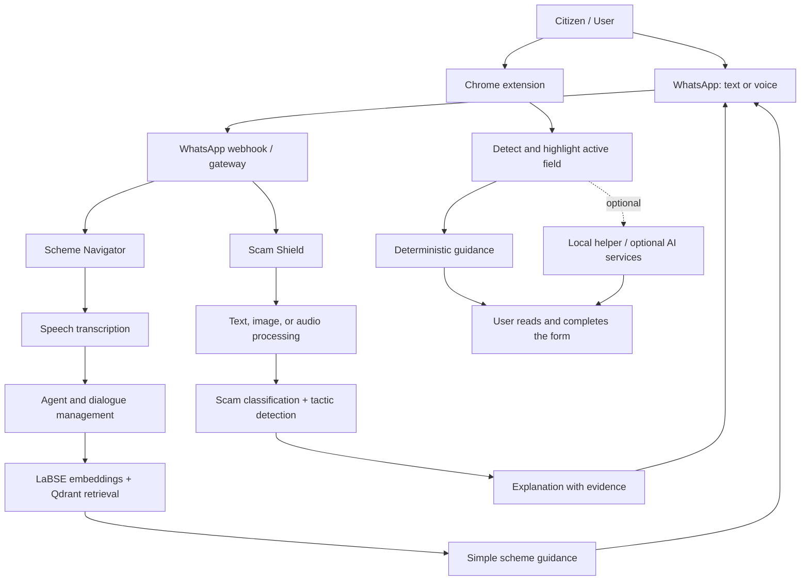

# 🇮🇳 Suraksha Mitra

**One AI-powered companion for government-scheme discovery, digital-fraud awareness, and safer online applications.**

[](https://github.com/niteshislol/Suraksha-Mitra) [](https://www.whatsapp.com/) [](https://www.google.com/chrome/)

## 🎬 Demo

[](https://youtu.be/F7wlnq0CGLQ)

**Watch:** [Suraksha Mitra — project demo](https://youtu.be/F7wlnq0CGLQ)

---

## 🌱 About the project

Accessing public welfare schemes, identifying sophisticated digital scams, and understanding complicated online forms can be difficult—especially for people who face language, literacy, accessibility, or digital-confidence barriers.

**Suraksha Mitra** brings three complementary tools together under one solution:

1. **Scheme Navigator** — helps citizens discover potentially relevant government schemes through a voice-first WhatsApp conversation.
2. **Scam Shield** — analyses suspicious messages, screenshots, and voice notes and explains common fraud tactics in accessible language.
3. **Application Assistant** — a privacy-conscious Chrome extension that explains online form fields one at a time while leaving every form action to the user.

The goal is to make digital services easier to understand and safer to use—not to make decisions or take actions on a person's behalf.

## ✨ What Suraksha Mitra does

| Module | Where it works | Main capabilities |
|---|---|---|
| **Scheme Navigator** | WhatsApp | Voice-note or text-based scheme discovery, progressive profiling, multilingual retrieval, simple benefit summaries, and application guidance. |
| **Scam Shield** | WhatsApp-connected service and API | Text analysis, voice-note transcription, screenshot OCR, scam-risk classification, and explanations of suspected manipulation tactics. |
| **Application Assistant** | Chrome / Chromium extension | Detects visible form controls, highlights the current field, explains what it asks for, and provides multilingual spoken or written guidance. |

---

## 🧭 1. Scheme Navigator — Government schemes assistant

### The problem

Government schemes may support farmers, students, women, low-income households, and other communities, but citizens can struggle to find the right programme, interpret formal documents, or understand eligibility and application requirements. Typing a detailed query can be an additional barrier.

### How it works

1. **Ask by voice or text:** A citizen sends a WhatsApp message or voice note in a familiar language.
2. **Transcribe and understand:** ElevenLabs Scribe (`scribe_v1`) converts supported voice notes to text. The agent extracts known details and asks follow-up questions when important information is missing.
3. **Retrieve relevant schemes:** The retrieval-augmented generation (RAG) pipeline searches scheme data stored as embeddings in Qdrant Cloud. LaBSE sentence embeddings support cross-lingual semantic matching.
4. **Explain the result:** The agent turns retrieved information into a straightforward response about benefits, eligibility clues, documents, and next steps.
5. **Keep the conversation contextual:** Session handling supports progressive profiling, so users do not need to repeat every detail in each message.

### Scheme data

The supplied implementation describes data assembled from:

- National scheme datasets including `indian-government-schemes-2025` and `gov_myscheme_data`.
- A curated Chhattisgarh-specific dataset named `chhattisgarh_schemes_canonical`.
- A processing pipeline that normalises differing CSV formats, cleans records, chunks content, creates LaBSE embeddings, and ingests vectors into Qdrant Cloud.

**Important:** Scheme information can change. Users should confirm current eligibility, documents, deadlines, and application links with the relevant official government department or portal before acting.

---

## 🛡️ 2. Scam Shield — Multimodal fraud awareness

### The problem

Digital fraud is not limited to ordinary text messages. Suspicious content can arrive as a voice note, an image of a fake payment receipt, a bank-alert screenshot, or a message written in a regional language or code-mixed text such as Hinglish or Tanglish.

### How it works

1. A user forwards or submits suspicious text, an image, or a voice note through the configured interface.
2. **Audio:** ElevenLabs Scribe transcribes supported audio into text.
3. **Images:** Tesseract OCR extracts readable text from screenshots and images.
4. **Detection:** A language/script-aware pipeline evaluates the message with the configured classification model.
5. **Explanation:** The response identifies suspected risk patterns—such as urgency, authority impersonation, false rewards, credential phishing, loss aversion, or suspicious links—and provides evidence-based context to help the user assess the message.
6. **Feedback and monitoring:** The API supports feedback, health reporting, aggregate statistics, and metrics. Personal identifiers are scrubbed before persistent analysis logging.

### Detection models

The documented implementation supports two interchangeable model paths:

- **TF-IDF + Logistic Regression:** a lightweight baseline designed for lower-memory environments.
- **Fine-tuned XLM-RoBERTa exported to ONNX INT8:** a larger multilingual model intended to improve handling of code-mixed and adversarially modified text. The service can fall back to the baseline when the larger model artefact is unavailable.

The supplied Scam Shield evaluation reports the following validation results:

| Model | Validation F1 | Reported CPU p50 latency | Approx. artefact size |
|---|---:|---:|---:|
| TF-IDF + Logistic Regression | 0.9082 | 0.51 ms | 10.2 MB |
| Augmented XLM-RoBERTa, ONNX INT8 | 0.9980 | 4.44 ms | 278 MB |

**Evaluation caveat:** These are results on a held-out validation split, not proof of real-world scam-detection accuracy. The documented 15,477-row corpus is partly synthetic or of unverified provenance, and a separately hand-labelled real-message test set was still in progress in the supplied project notes. Users should treat the model as a warning and awareness aid, not as a guarantee that a message is safe or fraudulent.

---

## 📝 3. Application Assistant — Safer online form guidance

The Application Assistant is a privacy-conscious Chrome extension that helps users understand an online application **one field at a time**. It is designed to explain forms, not complete or submit them.

### Features

- Detects visible form controls in page order, including common text, email, telephone, number, date, time, textarea, radio, checkbox, select, file, contenteditable, and ARIA controls.
- Highlights the active field and explains what information it requests.
- Supports native dropdowns and many custom comboboxes.
- Provides deterministic fallback guidance for ambiguous, sensitive, or unsupported fields.
- Offers guidance in **Hindi, Bengali, Gujarati, Punjabi, and English**.
- Uses ElevenLabs for spoken guidance when configured, with the browser's speech engine as a fallback.
- Can use Ollama/Gemma for contextual explanations. Local-only mode disables AI requests and uses deterministic guidance.

### User-in-control design

The extension does **not** automatically fill fields, click controls, authenticate, bypass CAPTCHA or OTP checks, or submit forms. The user reads the explanation, enters information themselves, and chooses when to move to the next field.

For optional AI guidance, the extension is designed to send only a small crop around the active field and non-sensitive guidance metadata—not the full page or the user's field values. Typed values are masked locally before an allowed visual request. Unmasked screenshot capture is disabled by default and requires explicit opt-in plus an HTTPS backend controlled by the user.

---

## 🏗️ High-level architecture



*The diagram shows the logical solution architecture. Actual routing and the WhatsApp provider depend on the deployment configuration.*

## 🧰 Technology stack

| Area | Technologies |
|---|---|
| Backend services | Python, FastAPI, Uvicorn, Starlette |
| WhatsApp integration | Meta WhatsApp Cloud API; a Twilio-compatible webhook adapter is also documented in the Scam Shield service |
| Speech | ElevenLabs Scribe for voice-note transcription; ElevenLabs speech output and browser speech fallback for form guidance |
| LLM and dialogue | Groq-hosted Llama 3; optional Ollama/Gemma fallback or local contextual guidance |
| Retrieval / embeddings | Qdrant Cloud, Sentence-Transformers, LaBSE, RAG |
| Scam detection | TF-IDF, Logistic Regression, XLM-RoBERTa, ONNX Runtime INT8 |
| Image text extraction | Tesseract OCR, Pillow |
| Local persistence / feedback | SQLite for Scam Shield feedback and scrubbed analysis records; in-memory sessions for the scheme assistant |
| Browser extension | Chrome Manifest V3, JavaScript, HTML/CSS, Node.js helper |
| Development and testing | ngrok, Node.js test runner, pytest, Ruff, mypy, Vulture |

### WhatsApp integration note

The Scheme Navigator implementation documents direct Meta WhatsApp Cloud API integration and a central `whatsapp_gateway.py` router. The Scam Shield service also documents a Twilio-compatible `/api/sms-webhook` endpoint that responds in TwiML. These webhook formats are provider-specific; configure the gateway or adapter for the provider used in your deployment rather than sending one provider's payload to another provider's endpoint unchanged.

---

## 🚀 Getting started

Suraksha Mitra contains three independently configurable components. Run commands from the corresponding component directory. The example folder names below are `Suraksha-Schemes`, `ScamShield-AI`, and `application_assistent`; adapt them if your consolidated repository uses different names.

### Prerequisites

- Python for the backend services. The Scheme Navigator documentation specifies Python 3.10+.
- Node.js 18+ for the Application Assistant's local helper and tests.
- Google Chrome or another Chromium-based browser that supports Manifest V3.
- Optional service credentials: Meta WhatsApp Cloud API, ElevenLabs, Qdrant Cloud, and Groq.
- Optional Ollama installation for local/contextual form explanations or configured fallback models.
- An ngrok account or another secure webhook tunnel for local WhatsApp webhook testing.

### A. Scheme Navigator

```bash
# Run from the Scheme Navigator component directory
python -m venv venv
# Windows PowerShell: .\venv\Scripts\Activate.ps1
# macOS/Linux: source venv/bin/activate
pip install -r requirements.txt
```

Create a `.env` file from `.env.example` and configure the credentials required by that component. Use the exact environment-variable names in the provided template. Then start the backend:

```bash
uvicorn src.whatsapp_server:app --port 8001
```

If using the unified WhatsApp router, start it in the directory containing the gateway:

```bash
python whatsapp_gateway.py
```

Expose the port actually used by the selected server, for example `ngrok http 8001` for the Scheme Navigator, then configure the resulting HTTPS URL in the Meta Developer Dashboard. Confirm the gateway's configured port before creating its tunnel.

### B. Scam Shield

```bash
# Run from the Scam Shield component directory
python -m venv .venv
# Windows PowerShell: .\.venv\Scripts\Activate.ps1
# macOS/Linux: source .venv/bin/activate
pip install -r requirements-dev.txt
```

Create `.env` from `.env.example`. To reproduce the documented lightweight baseline pipeline, run:

```bash
python -m scripts.download_data
python -m scripts.build_dataset
python -m scripts.train_tfidf
```

Start the API using the baseline model:

```bash
# macOS/Linux
SCAMSHIELD_MODEL=tfidf-lr python -m src.main
```

```powershell
# Windows PowerShell
$env:SCAMSHIELD_MODEL = "tfidf-lr"; python -m src.main
```

To use the documented ONNX INT8 encoder instead, install the requirements specified by the component and follow its model-download instructions. The encoder requires substantially more memory than the baseline.

Documented API routes include:

| Endpoint | Method | Purpose |
|---|---|---|
| `/api/analyze` | POST | Returns scam probability/label, detected language and script, tactic scores, evidence, and explanation |
| `/api/sms-webhook` | POST | Twilio-compatible WhatsApp/SMS webhook |
| `/api/feedback` | POST | Records a user's correction for an analysis |
| `/api/stats` | GET | Aggregate dashboard statistics |
| `/api/health` | GET | Reports service health and the model currently serving |
| `/metrics` | GET | Prometheus metrics |

Run the component's automated tests and quality checks from its directory:

```bash
pytest tests/ -q
ruff check src scripts tests
vulture src scripts tests --min-confidence 80
mypy --explicit-package-bases --namespace-packages src scripts tests
```

### C. Application Assistant

1. Open the `application_assistent` directory in a terminal.
2. Install/verify the local helper setup:

```powershell
npm install
Copy-Item .env.example .env
notepad .env
npm start
```

3. Add `ELEVENLABS_API_KEY` to the local `.env` file if you want ElevenLabs voice output. The helper reads this value at startup and listens on `http://127.0.0.1:8787` by default. Restart the helper after changing the key.
4. Open `chrome://extensions`, enable **Developer mode**, click **Load unpacked**, and select the `application_assistent` folder.
5. Open a compatible form, use the green **स** floating button, choose a language, review the highlighted field, and enter the information yourself.

To run the extension tests and syntax checks:

```powershell
npm test
node --check src\content\control-adapters.js
node --check src\content\content-script.js
node --check src\background\service-worker.js
node --check src\ui\popup.js
node --check server\screenshot-server.js
```

For testing local HTML demo forms, enable **Allow access to file URLs** on the extension's Details page and reload the page. Never use real credentials, identity documents, OTPs, or other private information in demo forms.

---

## 🔐 Privacy and safety principles

Suraksha Mitra is designed to support users while keeping sensitive decisions and actions in their hands.

- **No automatic form completion or submission:** the Application Assistant never fills fields, clicks controls, or submits applications on the user's behalf.
- **Sensitive controls get safe fallback guidance:** password, OTP, PIN, and similar fields are not treated as ordinary prompts for an AI model.
- **Minimise visual context:** optional form guidance uses a crop around the active field rather than sending the full page; local-only mode avoids AI requests.
- **Keep secrets out of source control:** store API keys in local environment files, keep `.env` private, and never commit it.
- **Scrub scam-analysis logs:** Scam Shield documents removal of phone numbers, email addresses, UPI handles, and long identifiers before persistent storage. Message text should not be written to ordinary application logs.
- **Explain, don't overrule:** scam warnings and scheme summaries are decision-support information, not guarantees or official determinations.
- **Verify before acting:** users should independently confirm suspicious payment requests and verify scheme details on official channels.

## 🗂️ Logical repository layout

The three components may be stored as sibling folders or maintained as separate repositories. A consolidated project can use a structure like this:

```text
Suraksha-Mitra/
├── Suraksha-Schemes/          # WhatsApp scheme discovery, RAG, sessions, gateway
├── ScamShield-AI/             # Scam analysis API, models, scripts, tests, results
└── application_assistent/     # Chrome extension, local helper, example forms, tests
```

Key files described in the supplied component documentation include:

- Scheme Navigator: `src/agent.py`, `src/whatsapp_server.py`, `src/session_manager.py`, and `whatsapp_gateway.py`.
- Scam Shield: `src/`, `scripts/`, `tests/`, `results/`, `docs/`, `configs/`, and `static/`.
- Application Assistant: `manifest.json`, `src/background/`, `src/content/`, `src/shared/`, `src/ui/`, `server/screenshot-server.js`, and `examples/`.

## 🧪 Testing and responsible evaluation

- Run each component's tests from that component's directory.
- Test on sample or synthetic form data; never use real credentials or OTPs.
- Validate scheme answers against official sources, especially before presenting deadlines, eligibility rules, or benefit amounts.
- Evaluate scam detection on a diverse, independently labelled set of real Indian messages before making claims about production accuracy.
- Review logging, permissions, API-key handling, and webhook verification before deployment.

## 🤝 Contributing

Contributions are welcome. Please preserve the core guarantees: protect personal information, avoid committing secrets or private datasets, keep user actions explicit, and communicate model limitations honestly. Before publishing the consolidated repository, ensure its root license and any dataset/model licences and attributions are documented correctly.

---

**Built to help people access public benefits, recognise digital fraud, and navigate online services with greater confidence.**
